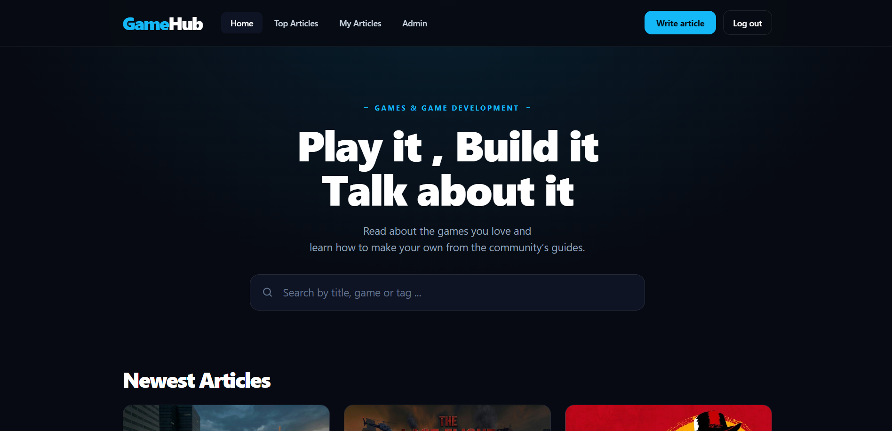
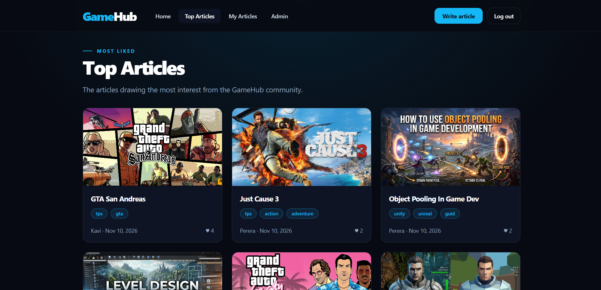
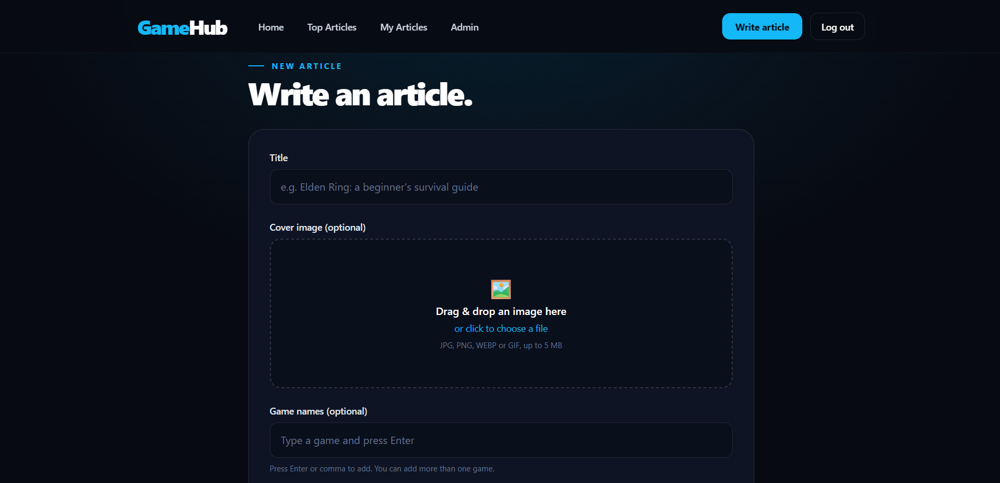
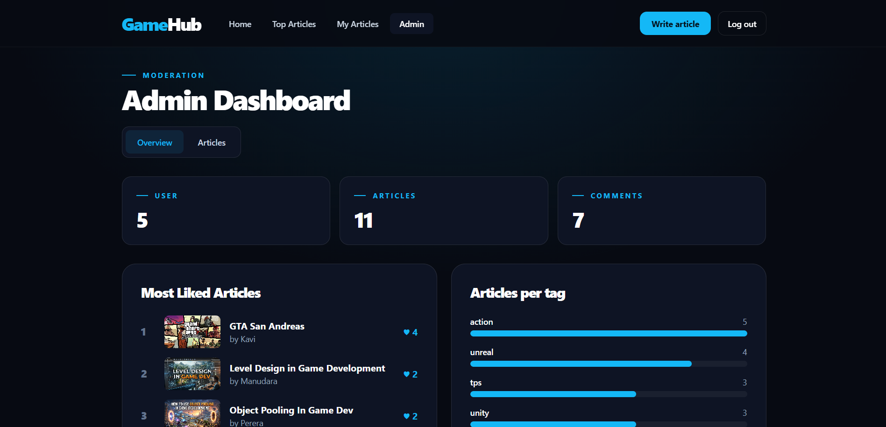
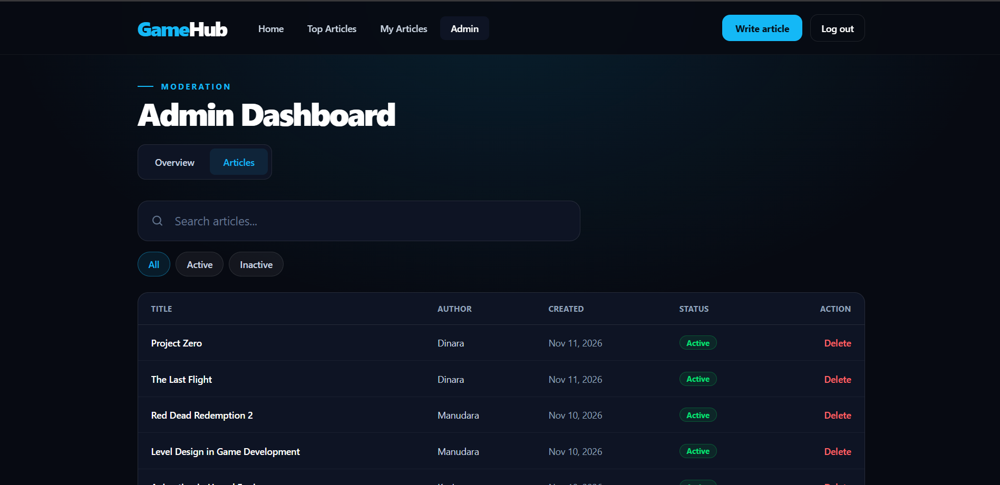

# GameHub Client

Frontend for **GameHub**, a community where players read about video games and beginner developers learn game development through "How to" articles. Users can publish, like and comment on articles and admins can moderate content.


## Live Demo

| | Link |
|---|---|
| Website | https://gamearticleweb.vercel.app/|
| Backend API | https://article-site-api.vercel.app/|
| Backend repository | https://github.com/sasinduKavishka-123/Article-Site-API.git |

## Screenshots


- Home  
---
- Top Articles 
---
- Create Article 
---
- Admin Dashboard 
---
- Admin Article 

## Features

- **Authentication:** register and login pages with form validation, and protected routes that redirect to login
- **Home feed:** newest-first article grid with debounced search, tag filters and pagination. Filters are kept in the URL so they can be shared
- **Article page:** cover image hero, tags, game names, likes and comments
- **Create and edit articles:** title, tags, game names and plain-text content, with live validation
- **Image upload:** drag and drop or choose a cover image, with a preview and file type and size checks
- **AI text generation:** generate an introduction paragraph from the article title
- **My articles:** a page listing the logged-in user's own articles
- **Top articles:** a page listing the top liked articles by users
- **Comments and likes:** add and delete comments, toggle likes
- **Admin dashboard:** statistics, most liked articles, articles per tag, and tables to delete or restore articles and delete comments
- **Responsive dark UI:** works on mobile, tablet and desktop, with accessible forms and dialogs

## Tech Stack

| Area | Technology |
|---|---|
| Language | TypeScript |
| UI library | React |
| Build tool | Vite |
| Styling | Tailwind CSS |
| Routing | React Router |
| HTTP client | Axios |
| State | React Context API (authentication) |
| Hosting | Vercel |

## Project Structure

```text
src/
├── main.tsx                  # App entry, providers
├── App.tsx                   # Route definitions
├── index.css                 # Tailwind import and theme colors
├── components/
│   ├── layout/               # Navbar, Footer, MainLayout
│   ├── articles/             # ArticleCard, ArticleForm, ArticleHero,
│   │                         # ImageDropzone, TagInput, LikeButton,
│   │                         # AiTextGenerator
│   ├── comments/             # CommentSection
│   ├── admin/                # StatCard, TagBars, MostLikedList
│   ├── ui/                   # TagPill, Pagination, SearchBar, ConfirmModal,
│   │                         # StatusBadge, CoverImage, Spinner, EmptyState
│   └── AuthLayout.tsx        # Shared layout and inputs for login and register
├── context/
│   └── AuthContext.tsx
├── hooks/
│   └── useAuth.ts
├── pages/
│   ├── Login.tsx
│   ├── Register.tsx
│   ├── Home.tsx
│   ├── ArticleDetail.tsx
│   ├── CreateArticle.tsx
│   ├── EditArticle.tsx
│   ├── MyArticles.tsx
│   ├── TopArticles.tsx
│   ├── NotFound.tsx
│   └── admin/                # AdminLayout, Overview, AdminArticles
├── router/
│   └── index.tsx             # All the Routes
├── service/
│   ├── api.tsx
│   ├── article.tsx
│   ├── auth.tsx
│   └── comment.ts
├── types/
│   └── types.ts              # Shared TypeScript types
└── utils/
    ├── formatDate.ts
    └── normalizeTags.ts
```

## Routes

| Path | Page | Access |
|---|---|---|
| `/login` | Login | Public |
| `/register` | Register | Public |
| `/` | Home feed | Logged in |
| `/articles/new` | Create article | Logged in |
| `/articles/:id` | Article detail | Logged in |
| `/articles/:id/edit` | Edit article | Author only |
| `/my-articles` | My articles | Logged in |
| `/top-articles` | Top articles | Logged in |
| `/admin` | Dashboard overview | Admin |
| `/admin/articles` | Manage articles | Admin |
| `*` | Not found | Logged in |


## Getting Started

### Prerequisites

- Node.js 20 or newer
- The [GameHub API](https://github.com/sasinduKavishka-123/Article-Site-API.git) running locally or deployed

### Installation

```bash
git clone https://github.com/sasinduKavishka-123/Article-Site-API.git
cd Article-Site-API
npm install
```

### Environment Variables

Create a `.env` file in the project root:

```text
VITE_API_BASE_URL=http://localhost:5000/api
```

| Variable | Description |
|---|---|
| `VITE_API_BASE_URL` | Base URL of the backend API, including `/api` |

Vite reads this value at build time. After changing it, restart the dev server or rebuild.

### Vite configuration

Past this inside the **vite.config.ts** file

```
import tailwindcss from '@tailwindcss/vite'
import react from '@vitejs/plugin-react'
import { defineConfig } from 'vite'

export default defineConfig({
  plugins: [react(), tailwindcss()],
  server: {
    port: 3000
  }
})
```

### Running the App

```bash
npm run dev       # start the dev server at http://localhost:3000
```

## Backend Connection

The app talks to the backend through a single Axios instance in `src/service/api.ts`. It:

- Adds the saved JWT to every request as `Authorization: Bearer <token>`
- Redirects to `/login` when the server answers `401` on a protected page
- Turns API errors into readable messages for the forms

## Styling

The UI is built with Tailwind CSS using a dark theme. The custom colors are defined in `src/index.css` with a `@theme` block:

| Name | Use |
|---|---|
| `base` | Page background |
| `card` | Cards and panels |
| `field` | Inputs |
| `accent` | Buttons, links and highlights |


## Related Repository

Backend: [gamehub-api](https://github.com/sasinduKavishka-123/Article-Site-API.git) (Express, TypeScript, MongoDB Atlas, Supabase Storage)

## Author

**Sasindu Kavishka**
- GitHub: [sasinduKavishka-123](https://github.com/sasinduKavishka-123)
- LinkedIn: [Sasindu Kavishka](https://www.linkedin.com/in/sasindu-kavishka-287b813a7/)
